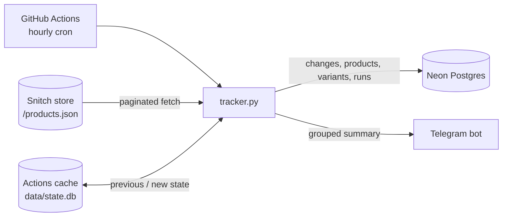

# Snitch Sale Tracker

An automated price and inventory tracker for the [Snitch](https://www.snitch.co.in) online store.
Every hour it fetches the full product catalog, detects every change since the previous run, stores a
permanent change history in Postgres, and sends a grouped summary to Telegram.

## Features

- **Full-catalog monitoring** — tracks every product and every variant (size/colour), ~23k products per run.
- **Change detection** — price, MRP, sale start/end and discount %, stock (sold out / back in stock),
  new and removed products and sizes, products returning to the site, and changes to name, URL, category,
  tags, launch date, main image and description.
- **Permanent history** — every change is written to a `change_log` table with its old and new value,
  so price history can be queried at any time.
- **Telegram alerts** — one grouped summary per run, with price and sale changes listed first and long
  summaries split across messages within Telegram's size limit.
- **Serverless & free to run** — scheduled on GitHub Actions; no server to maintain.
- **Built-in safeguards**
  - The first run saves a baseline only, so no false alerts are sent.
  - Temporary errors (HTTP 429/5xx, network issues) are retried with backoff; if the fetch still fails,
    the run stops instead of reporting products as removed.
  - Removal detection is skipped when far fewer products than expected are returned.
  - All database writes for a run happen in a single transaction; if it fails, the local state is not
    advanced, so the next run picks up the same changes again.
  - A failed Telegram delivery marks the GitHub run as failed, while the data is still saved.

## Architecture



1. **Schedule** — GitHub Actions starts the workflow every hour (and on demand).
2. **Restore state** — the previous snapshot (`data/state.db`, SQLite) is restored from the Actions cache.
3. **Scrape** — the catalog is read from the store's public Shopify `products.json` endpoint, 250 products per page.
4. **Diff** — the new snapshot is compared field-by-field against the previous one.
5. **Persist** — changes and updated rows are written to Neon Postgres in one transaction.
6. **Save state** — the new snapshot is saved back to the Actions cache for the next run.
7. **Alert** — a summary of all changes is sent to Telegram.

Example alert:
```
🛍 Snitch: 3 changes (29 Oct, 02:17 PM)
• Sale status: 1
• Price: 1
• Stock: 1

🔥 Sale started: Oversized Shirt [M] (40% off)
📉 Oversized Shirt [M]: ₹1999.00 → ₹1199.00
❌ Sold out: Cargo Pants [32]
```

## Tech Stack

| Area | Technology |
|---|---|
| Language | Python 3.12 |
| HTTP | `requests` |
| Scheduling / CI | GitHub Actions (cron + Actions cache) |
| Permanent storage | Neon (serverless Postgres) via `psycopg` 3 |
| Comparison state | SQLite |
| Notifications | Telegram Bot API |

## Project Structure

```
.
├── .github/workflows/track.yml   # Hourly GitHub Actions workflow
├── tracker.py                    # Main tracker: fetch, diff, persist, alert
├── check_site.py                 # One-time check that the store's products.json is reachable
├── requirements.txt              # Python dependencies
├── .env.example                  # Template for local environment variables
└── .gitignore
```

### Database schema (Neon)

| Table | Contents |
|---|---|
| `products` | Latest details for each product, first-seen time and removed flag |
| `variants` | Price, MRP, stock and sale status for each size/colour |
| `change_log` | One row per detected change: timestamp, entity, field, old value, new value |
| `runs` | One row per run: product/variant counts, number of changes, whether the fetch was complete |

## Setup

### 1. Check the store endpoint
```bash
pip install -r requirements.txt
python check_site.py
```
Use the URL reported as working as `STORE_URL`.

### 2. Run locally
Copy `.env.example` to `.env` and fill in the values (`.env` is git-ignored). Without `DATABASE_URL`,
all data is stored in local SQLite; without the Telegram values, alerts are printed to the console.
```bash
python tracker.py   # first run: saves the baseline
python tracker.py   # later runs: report changes
```

### 3. Create a Telegram bot
1. Create a bot with [@BotFather](https://t.me/BotFather) and copy its token.
2. Send any message to the bot.
3. Open `https://api.telegram.org/bot<TOKEN>/getUpdates` and copy the `chat.id` value.

### 4. Create a Neon database
Create a free project at [neon.com](https://neon.com) (a US East region is closest to GitHub's runners) and
copy its connection string. Tables are created automatically on the first run.

### 5. Configure GitHub
In **Settings → Secrets and variables → Actions**, add:

| Type | Name | Purpose |
|---|---|---|
| Secret | `DATABASE_URL` | Neon connection string |
| Secret | `TELEGRAM_BOT_TOKEN` | Telegram bot token |
| Secret | `TELEGRAM_CHAT_ID` | Telegram chat to send alerts to |
| Variable | `STORE_URL` | Store URL from step 1 (optional; defaults to `https://www.snitch.co.in`) |

Then open **Actions → Snitch tracker → Run workflow** to trigger the first run.

> Never commit secret values. Keep them only in GitHub Secrets and your local `.env` file.
> GitHub masks secrets as `***` in workflow logs.

## Querying the data

Most recent changes, with product and size names:
```sql
SELECT c.ts, p.title, v.title AS size, c.field, c.old_value, c.new_value
FROM change_log c
JOIN products p ON p.id = c.product_id
LEFT JOIN variants v ON v.id = c.entity_id AND c.entity = 'variant'
ORDER BY c.ts DESC
LIMIT 50;
```

## Troubleshooting

If a run fails, open it in the Actions tab and check the **Run tracker** step:

| Log message | Meaning |
|---|---|
| `❌ Fetch failed` | The store did not respond after all retries. The next run will try again. |
| `❌ Neon save failed` | The database could not be reached. Nothing was saved; the next run will catch up. Check `DATABASE_URL` if it keeps happening. |
| `❌ Telegram error: 401` | The bot token is invalid. |
| `❌ Telegram error: 404` | The bot token is malformed (often a copy-paste issue). |
| `❌ Telegram error: 400 ... chat not found` | `TELEGRAM_CHAT_ID` is wrong, or the bot has not been messaged yet. |
| `❌ TELEGRAM_BOT_TOKEN / TELEGRAM_CHAT_ID secret is missing on GitHub.` | Add both secrets. |

GitHub may delay or skip scheduled runs during periods of high load, so runs are not guaranteed every hour.

## Responsible Scraping

This is a personal, low-frequency project:

- It reads only the store's **public** `products.json` endpoint — no login, no private data, no checkout or cart actions.
- It runs at most **once per hour**, waits **2 seconds between pages**, and identifies itself with a
  descriptive User-Agent.
- It honours `Retry-After` and backs off on rate limiting (HTTP 429) and server errors.
- Collected data is used only for personal price tracking and is not redistributed.

Please respect the store's terms of service and robots policy if you adapt this project.

## Future Improvements

- Track additional sources (e.g. the mobile app) alongside the website (`source` column is already in place).
- Per-product watchlists and price-drop thresholds, so alerts can be filtered.
- A small dashboard for price history charts.
- Unit tests for the diff logic and a CI check on pull requests.
- Exact stock levels, if the store exposes `inventory_quantity`.
